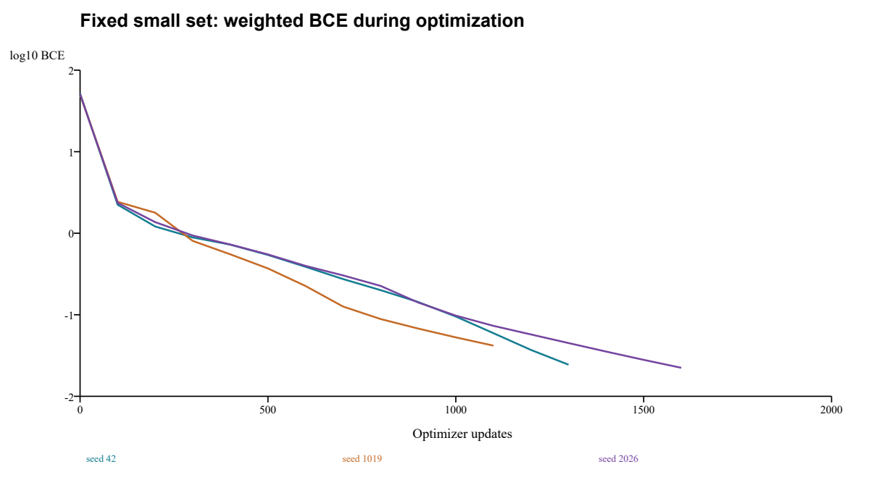
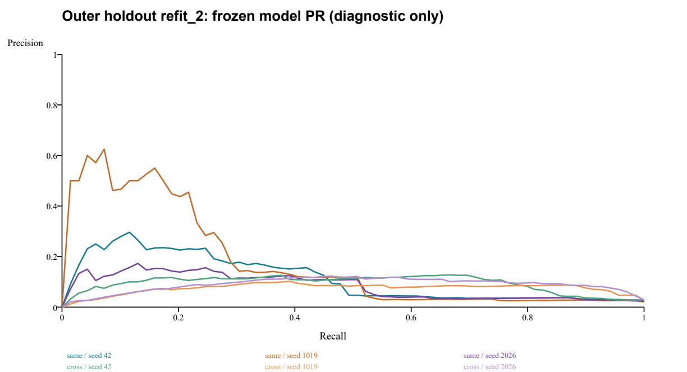
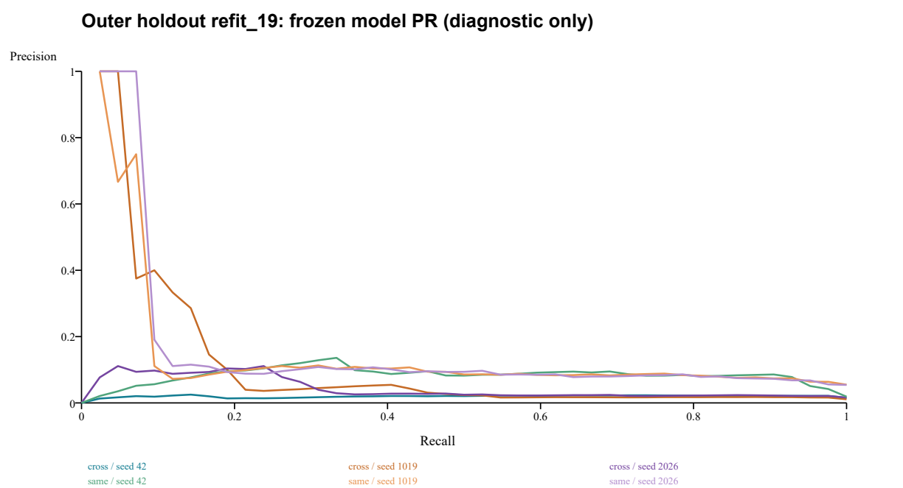
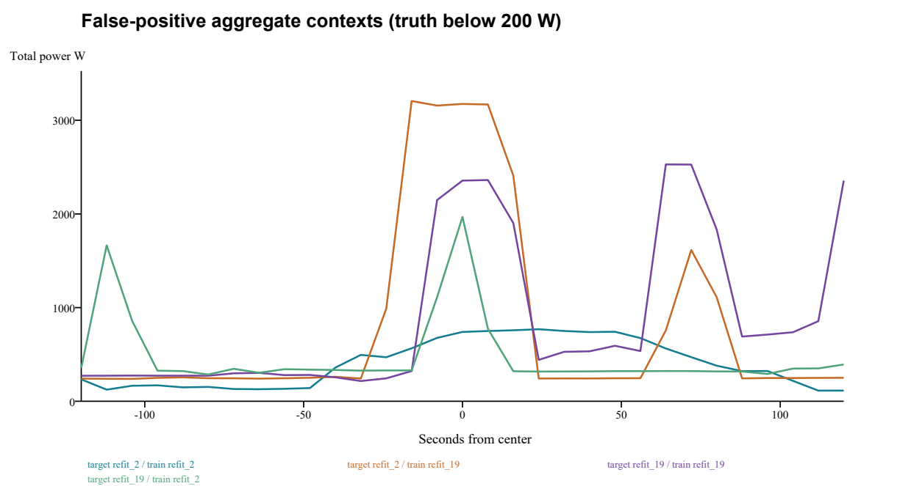

# 微波炉小样本能力检查与同户/跨户诊断报告

日期：2026-10-25。运行：`microwave-diagnosis-20261025-v2`。9次拟合全部完成，12份外层预测先冻结后统一评价。仅House2/19；House17未重新验收，最终House8/9/20未访问。旧默认模型未替换。

## 结论

小集合能够学会，3/3种子达到预定标准；不能把当前低精确率主要解释为网络完全不能优化、无参数更新或窗口取中心的实现错位（原始传感器时间偏差仍未排除）。同户时间留出仍明显退化：两户平均Recall仅38.65%/64.29%，即使事后重设阈值到Recall≥85%，Precision也只有3.44%/7.91%。因此户间变化不是唯一瓶颈。

同户优势有方向差异。目标House19：同户AP12.60%对跨户5.72%，诊断R85处FPR2.08%对8.28%，满足登记优势标准。目标House2：同户AP12.20%对跨户8.61%，差3.59个百分点未达5个百分点，诊断R85处FPR反而10.70%对5.07%。两个方向并不一致，不能宣布“同户明显优于跨户”是普遍结论。

证据支持：数据有效支持稀缺、同户时间/负载组合变化、阈值迁移与分数排序退化共同作用。不能给出各原因的因果贡献百分比，也不能据一次小规模诊断断言8秒单通道任务不可解。

## 数据可用性与训练前修订

v1在准备阶段发现House19前7天没有任何完整C31开机窗，原定7/3/4天划分不可行，0次拟合。其失败目录和日志保留。按可用性在任何训练前改为v2：两户共同使用相对起点第8–11天训练、11–12天内部验证、12–14天外层留出，第11/12天边界各侧剔除1800秒。完整31点上下文位于所属块内，跨界阈值段整段排除，无插值、无缺失填零。

House19前8天原标签存在开机，但每日完整总表窗仅0/40/8/19/7/0/23/16个，开机窗全为0；原聚合记录含coverage=.875、incomplete_coverage、observation_gap。说明原始标签正数不等于模型可见正窗数。归一化文件中总表缺失House2为14216/151200、House19为12960/151200，标签缺失均15120/151200。无法恢复上游已前填/填零及IAM截断带来的信息。逐日统计见`daily_support.json`。

|家庭|分区|有效窗|开机窗|阈值连续段|开机占比|有效小时|
|---|---|---|---|---|---|---|
|refit_2|train|21317|166|19|0.779%|47.37|
|refit_2|validation|7962|59|7|0.741%|17.69|
|refit_2|outer|16325|69|8|0.423%|36.28|
|refit_19|train|25133|141|25|0.561%|55.85|
|refit_19|validation|9869|94|18|0.952%|21.93|
|refit_19|outer|20787|42|7|0.202%|46.19|

上述阈值连续段不等于独立物理周期；相邻窗口高度相关。训练名义3天，实际有效时长47.37/55.85小时；内部验证只有7/18段，外层仅8/7段。不同户时间并非相同日历天。支持筛选限制结论外推。

## 小集合能否学会

每户最早4个完整可用训练开机段，共8段66个正中心；按同户总表中心功率最近匹配66个易混淆关闭窗，按低功率且时间最近匹配66个易关闭窗，共198窗。清单含户、UTC中心、窗口标识、原始行、事件、真实功率及配对原因。负窗彼此可邻近相关，此集合不作为独立泛化样本。

沿用现有C31输入形式、历史来源log1p统计、两层CNN、Adam .001、BCE pos_weight50，固定全集合优化；阈值.5。开始三个种子TP均0、FN66，加权BCE约50–52；每100步检查。P/R≥.98、AP≥.99、BCE≤.1连续两次则停止，上限2000步。所有实际梯度与参数更新非零、输入有限，原API标签与独立时间映射逐点一致。

|种子|更新数|TP|FP|FN|TN|P|R|加权BCE|判据|
|---|---|---|---|---|---|---|---|---|---|
|42|1300|66|0|0|132|100.00%|100.00%|0.02442|通过|
|1019|1100|66|1|0|131|98.51%|100.00%|0.04184|通过|
|2026|1600|66|0|0|132|100.00%|100.00%|0.02238|通过|



AP最终三者均为1。训练初始、每次检查、最终逐样本得分与正负分位数均保存。1019最终1个关闭窗仍过.5，但正样本排序完整领先负样本；符合预登记98%标准。小集合成功表明能在有限样本上学习，不能排除总体容量/特征表达不足、全量优化或稀疏正例采样问题。

## 同户/跨户控制结果

6模型均从头训练、自然类别比例shuffle、训练块独立估计log1p统计；没有困难挖掘或新网络变体。内部验证以Recall≥.85的精确PR点选阈值，再按P/F1/较早轮次选检查点。外层标签物理分离，所有模型和阈值及12份预测封存后才统一评分。对同一目标户，同户/跨户使用完全相同的有效时间点与正类比例。以下均为3种子算术均值，不能视作3个独立家庭。末两列是各留出分区事后阈值的诊断上界，禁止部署或作为通过验收依据。

|目标|训练来源|P|R|F1|AP|冻结阈值FPR|诊断P@R85|诊断FPR@R85|
|---|---|---|---|---|---|---|---|---|
|refit_2|同户|10.66%|38.65%|15.60%|12.20%|2.14%|3.44%|10.70%|
|refit_2|跨户|9.74%|52.17%|16.30%|8.61%|2.14%|7.48%|5.07%|
|refit_19|同户|8.72%|64.29%|15.35%|12.60%|1.36%|7.91%|2.08%|
|refit_19|跨户|1.94%|41.27%|3.68%|5.72%|4.41%|2.10%|8.28%|

冻结阈值下两户同户Recall均未达到85%。House2跨户F1均值略高于同户，且其R85处误报率更低；不能只报告同户AP略高而忽略这一反例。AP比较仅在相同目标支持上可直接解读，不以两户Precision落差直接推断迁移。





## 分清阈值漂移与排序退化

下表为每个训练户所选模型在训练重放、内部验证、同户外层上的均值。训练重放只检查拟合程度。即使独立放宽留出阈值达到85%召回，外层误报率仍明显高于训练及内部验证；AP也降低。因此仅重新校准阈值不能恢复原排序质量。

|训练户|分区|AP|冻结阈值R|诊断P@R85|诊断FPR@R85|
|---|---|---|---|---|---|
|refit_2|train|65.91%|86.95%|44.61%|0.85%|
|refit_2|validation|53.78%|88.70%|30.98%|1.54%|
|refit_2|same_house_outer|12.20%|38.65%|3.44%|10.70%|
|refit_19|train|62.41%|92.43%|59.74%|0.34%|
|refit_19|validation|43.92%|85.46%|43.38%|1.07%|
|refit_19|same_house_outer|12.60%|64.29%|7.91%|2.08%|

House2内部验证到同户外层AP下降41.58个百分点，House19下降31.32个百分点。分区类别比例不同会影响AP/P，但诊断固定召回处FPR同样升高（1.54%→10.70%、1.07%→2.08%），支持存在超出先验比例变化的性能退化。仍不能把它唯一归因于硬件容量或负载变化：验证仅一天，事件支持少，且检查点选择有内验证乐观偏差。

## 逐种子冻结阈值结果

事件命中指该阈值段至少一个有效开机中心被识别；不能代替逐点Recall或完整事件召回。连续分数完整PR存于evaluation/pr_*.npz，固定.5的全部计数与指标存于results.json的fixed_half。

|训练户|目标户|种子|P|R|F1|AP|TP|FP|FN|TN|FPR|阈值|段命中|
|---|---|---|---|---|---|---|---|---|---|---|---|---|---|
|refit_2|refit_2|42|14.94%|37.68%|21.40%|11.17%|26|148|43|16108|0.91%|0.931317|5/8|
|refit_2|refit_19|42|1.38%|23.81%|2.61%|2.01%|10|715|32|20030|3.45%|0.931317|3/7|
|refit_2|refit_2|1019|4.36%|50.72%|8.04%|17.23%|35|767|34|15489|4.72%|0.558639|6/8|
|refit_2|refit_19|1019|1.61%|52.38%|3.13%|10.78%|22|1341|20|19404|6.46%|0.558639|4/7|
|refit_2|refit_2|2026|12.67%|27.54%|17.35%|8.20%|19|131|50|16125|0.81%|0.898748|4/8|
|refit_2|refit_19|2026|2.81%|47.62%|5.31%|4.36%|20|691|22|20054|3.33%|0.898748|5/7|
|refit_19|refit_2|42|10.34%|43.48%|16.71%|9.40%|30|260|39|15996|1.60%|0.820631|4/8|
|refit_19|refit_19|42|9.12%|64.29%|15.98%|8.31%|27|269|15|20476|1.30%|0.820631|7/7|
|refit_19|refit_2|1019|7.44%|55.07%|13.10%|7.48%|38|473|31|15783|2.91%|0.923772|7/8|
|refit_19|refit_19|1019|8.48%|66.67%|15.05%|13.95%|28|302|14|20443|1.46%|0.923772|6/7|
|refit_19|refit_2|2026|11.43%|57.97%|19.09%|8.95%|40|310|29|15946|1.91%|0.806654|6/8|
|refit_19|refit_19|2026|8.55%|61.90%|15.03%|15.53%|26|278|16|20467|1.34%|0.806654|6/7|

## 训练预算与选择

每模型3528次更新，批量上限256、末批可短；约89.5万窗口曝光。House2正例曝光6972次，House19约5017–5031次，窗口重复并非新事件。名义时长相同、更新预算相同，有效窗口/事件支持不同。House2约42次全训练集曝光，House19约35.6次；原C31来源全训练集约150069窗、646正窗、103段，3528步约6次曝光，因此不能将本轮与历史训练预算说成完全同等学习任务。

|训练户|种子|更新数|实际窗口曝光|正窗曝光|选中检查点|拟合秒数|
|---|---|---|---|---|---|---|
|refit_2|42|3528|895314|6972|11|8.77|
|refit_2|1019|3528|895314|6972|9|8.02|
|refit_2|2026|3528|895314|6972|12|9.80|
|refit_19|42|3528|895783|5031|12|8.26|
|refit_19|1019|3528|895783|5030|3|8.37|
|refit_19|2026|3528|895783|5017|6|9.44|

内部验证阈值约.56–.93；高阈值随训练冻结后迁移召回不足。较早最佳轮与末轮均在登记范围内保存，未按外层结果追加训练、改阈值或搜索模型。

## 误报案例对照

固定seed42，每个训练/目标组合选分数最高的误报，并在同一目标时间点查询另一来源模型分数。表内为“得分 / 各自冻结阈值”，真实微波炉功率均小于200W。窗口曲线是总有功功率；仅凭本图不能识别究竟是哪一种其他设备。

|目标户|按哪个训练户排序|UTC中心|真实W|总表中心W|同户得分/阈值|跨户得分/阈值|
|---|---|---|---|---|---|---|
|refit_2|refit_2|2014-10-11T16:43:44+00:00|0.0|740.0|0.998741 / 0.931317|0.014430 / 0.820631|
|refit_2|refit_19|2014-10-11T08:18:16+00:00|0.0|3174.2|0.457323 / 0.931317|0.999978 / 0.820631|
|refit_19|refit_19|2014-10-16T21:23:04+00:00|0.0|2355.9|0.999958 / 0.820631|0.734391 / 0.931317|
|refit_19|refit_2|2014-10-16T20:56:40+00:00|0.0|1968.0|0.991817 / 0.820631|0.998155 / 0.931317|



完整逐窗31点功率、两个来源分数见paired_error_cases.json。所有模型另保留每类至多3个、相隔至少248秒的TP/FP/FN案例（evaluation/error_cases.json）。最高分样例是机制线索，不能代表全部误报频率，更不能直接当成下一轮训练集。

## 既有证据核对

重新以旧C61权重对来源2/19的61点共同支持134673窗、559正中心推理，3种子的AP、P@R85、FPR@R85均与旧只读诊断JSON一致；重算训练P@R85均值17.37%、FPR1.71%。旧检查点历史的选中轮、末轮BCE和来源验证Precision也逐项一致。见docs/MICROWAVE_PRIOR_EVIDENCE_READBACK_20261025.json。原House5/17数字仅引用旧摘要，无新标签读取；旧开发P@R85约4.26%、FPR约5.5%仍是独立事后阈值诊断，不能部署。末轮训练损失下降而来源验证P下降的记录支持“不直接延长训练”。state-v2的PR读取缓存修复与模型训练不同，本轮没有因源码指纹不同而否定旧实验。

## 能支持、不能支持与下一步

已支持：①原C31实现能优化固定小集合；②有效完整上下文使可用开机支持显著缩水，名义14天不能代替有效事件统计；③同户时间变化已足以造成大幅性能退化；④House19有额外跨户损失，House2没有一致同户优势；⑤冻结阈值漂移和排序质量退化都存在。

不能排除：更丰富负载组合下的特征/容量瓶颈、稀疏正例梯度与采样不足、单日内部验证不稳定、上游预处理造成的信息损失。不能把低精确率唯一归因于损失权重或跨户，也不能证明信号不可辨识。训练/内部验证选择和外层差异不是随机因果试验，无法量化每个原因占比。

下一轮最小建议：先只做来源数据的独立质量审计，定位House19前8天coverage=.875及碎片化缺失的生成原因，逐时核对原始采样、重采样规则、标签和总表时间戳，不填补缺失来凑训练样本；以“有效完整事件支持”决定能否建立至少多个日期块的内验证。若数据核对正确，再单独预登记一个“真正增加每批正事件曝光”的采样对照：同一C31、归一化、唯一正负清单、更新数和损失保持一致，仅改变批次正事件曝光，按事件/日期分块，冻结阈值后再看新的来源时间留出；必须明确正例有效权重随采样改变。不要同时增加网络或延长训练，不复用本轮外层反复选配方。本轮未执行该建议。

## 复核与交付

入口scripts/run_microwave_diagnosis.py支持prepare/audit/small/train/evaluate/verify。新运行目录必须不存在，已完成阶段或单模型目录拒绝覆盖。封存入口可在工作区日后变化时使用；当前verify已完成12份外层预测的权重读回，状态逐点一致。补充独立核验另重建72份内部验证PR与选择、12份外层混淆/AP、3小集合权重与成功判据、训练归一化、上下文和事件隔离，全部通过。这是本机自动复核，不是第二成员或第二机器复现。

```powershell
.venv-m2/Scripts/python.exe scripts/run_microwave_diagnosis_snapshot.py verify --run outputs/accuracy/microwave-diagnosis-20261025-v2
.venv-m2/Scripts/python.exe scripts/verify_microwave_diagnosis.py
.venv-m2/Scripts/python.exe -m unittest discover -s tests -p test_microwave_diagnosis.py -v
```

重跑依次prepare、audit、small、train、evaluate、verify，各命令指定同一个全新--run。源码/输入/模型/预测哈希分别位于registration.json、models/*/complete.json、freeze.json，评价封存位于evaluation_complete.json，交付总清单delivery_manifest.json。window_manifest.csv、small_manifest.csv、events.json、support.json提供划分与样本身份；source快照可检查没有外层选择路径。

训练早期误调用一次evaluate，由缺少freeze.json的门禁阻止，未创建评价目录、未解析外层标签；随后在训练进程退出、freeze.json存在后正式评价成功。v1准备失败和该门禁日志保留。无额外拟合、无留出后搜索。必要测试5项和已有状态实验回归9项全部通过，共14项。交付复核时发现注册封存入口的目录定位错误，直接启动会在导入项目代码前失败。原封存入口未改写；新增scripts/run_microwave_diagnosis_snapshot.py只定位并加载登记源码以verify，修复副本和哈希收据存于execution_repair/，12份预测读回已通过。当前工作区入口亦修正了未来封存目录定位，不改变本轮训练源码。
