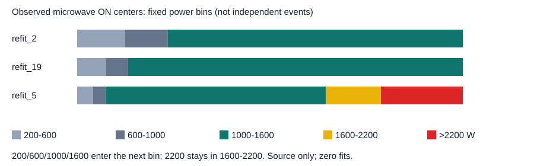

# 微波炉来源验证代表性审计与禁用划分提案（2026-10-25）

本轮完成 **0 拟合**。只使用原 House2/19 各14天、原 House5 14天来源数据，以及六个冻结 House5 块的来源预测。未读取 House17 真值、真值缓存、逐点开发预测或开发成绩，未访问最终 House8/9/20 数据。没有修改数据角色、既有运行、旧任务代码或训练数据。没有生成 House5 训练数组、归一化统计、采样池或模型。

结论：House5 与训练来源之间存在开机功率、可观测阈值段长度、正中心比例与总表背景的差异；因此单独用 House5 不能证明覆盖其他家庭。来源证据不支持把高功率模式直接判为标签错误，也不能证明新增 House5 训练能改善预测。本提案只证明固定时间范围具备一定支持，收益仍未知。

## 1. 范围、口径及可复核身份

原训练范围保持 House2 `[2014-09-29T06:28:48Z,2014-10-13T06:28:48Z)`、House19 `[2014-10-04T20:22:40Z,2014-10-18T20:22:40Z)`。原 House5 来源验证范围为 `[2014-11-14T20:53:44Z,2014-11-28T20:53:44Z)`。全部区间为绝对 UTC、左闭右开。

统计使用原8秒网格、200W开机阈值。完整 C31 要求31个总表点全部有效；partial 使用任务5已冻结的中心总表/标签有效、至少24个真实点、无连续两个缺失点规则。**House5 partial 仅作支持诊断，不是已授权训练，也不替换验证中心。** 缺失保留未知，不补零、不插值、不持有到额外时间。

阈值段是连续可观测的 ≥200W 网格，遇缺失即断开；它不等于独立物理事件。完整可观测段要求两侧关闭标签可见，且段内每个正中心都有指定窗口支持。以下比例为时间中心比例，不提供物理事件的因果占比。功率分箱为 `[200,600)`、`[600,1000)`、`[1000,1600)`、`[1600,2200]`、`>2200W`。

脚本只通过显式输入白名单读文件，不遍历数据目录、不导入训练模块、不加载模型权重。来源6个CSV全部按冻结 SHA-256 校验；三户时间轴均精确等于151,200个连续8秒网格，标签与总表逐点对齐。六个 House5 冻结块的中心时间完全一致、标签在浮点存储精度内一致。文件路径、哈希、字节数、41次程序读取清单见同名JSON和运行 `audit.json`。协议/目录元数据包含其他分区标识，本次只提取2/19/5来源项，不跟随其他数据路径。

`docs/MICROWAVE_DATA_AUDIT_20261025.md/.json` 的来源2/19审计结论仍成立：原始记录重放无数值、时间、缺失或质量标记差异，没有发现来源处理实现bug。本轮独立重算其下游窗口支持；没有重新读取整户原始记录。本轮也没有独立重放 House5 原始重采样，不能将2/19的原始重放结论外推到House5。

## 2. 全14天来源分布

|来源户|完整窗 / 正中心|partial窗 / 正中心|完整正比例|partial正比例|阈值段起始|完整可观测段 C31 / partial|
|---|---:|---:|---:|---:|---:|---:|
|House2|93,213 / 369|127,747 / 466|0.3959%|0.3648%|81|21 / 29|
|House19|56,856 / 277|132,059 / 383|0.4872%|0.2900%|83|27 / 27|
|House5|120,281 / 1,618|131,830 / 1,941|1.3452%|1.4724%|210|66 / 71|

2/19合计完整150,069窗/646正中心，partial259,806窗/849正中心；新增109,737窗/203正中心、**51个新增有支持阈值段**，与任务5实际 mask-v2 preparation 完全闭合。House5全14天包含被冻结双日块排除的边缘/剩余日期，不能与六块合计混用。

下表使用所有有效开机标签中心，避免把模型窗口可用性与功率分布混为一项。

|来源户|有效开机中心|开机W P25 / P50 / P90 / P99|200–600|600–1000|1000–1600|1600–2200|>2200|
|---|---:|---:|---:|---:|---:|---:|---:|---:|
|House2|478|1025 / 1098 / 1135 / 1153|59|53|366|0|0|
|House19|404|1199 / 1259 / 1322 / 1351|30|23|351|0|0|
|House5|2,141|1389 / 1436 / 2696 / 2778|88|69|1223|306|455|

House5高功率中心在现有来源范围内确实出现：455个 >2200W；训练两户没有1600W以上中心。该表支持不同幅度分布，而不是“某物理模式导致多少错误”。约1.4kW及约2.7kW的高端数值可见，但仅凭网格分布无法判断具体器具模式或是否包含其他负载。

|来源户|阈值段秒 P25 / P50 / P90 / 最大|关闭时总表W P50 / P90 / P99|开机时总表W P50 / P90|
|---|---:|---:|---:|
|House2|16 / 24 / 112 / 280|156 / 445 / 5244|1529 / 3656|
|House19|16 / 32 / 70.4 / 104|226 / 460 / 2307|1504 / 3844|
|House5|18 / 56 / 184 / 872|485 / 1573 / 3685|2295 / 4841|

House5阈值段更长、关闭时总表的中位数与P90更高；House2关闭背景P99反而更高，因此不能概括为所有分位数统一上移。段长度受缺失分割与8秒平均影响，不能视作独立物理周期持续时间。逐户UTC日、六个双日块、全区间以及提案块的完整统计（各分位数、正比例、段支持、总表开/关中心分布）在 `source_statistics.csv`。



## 3. 先验与条件变化应分开解释

先验线索：有效标签中的正比例为 House2 0.3513%、House19 0.2969%、House5 1.5574%；窗口筛选后比例也不同。Precision满足 `P = π·TPR / (π·TPR+(1−π)·FPR)`，所以跨户P/AP不能直接解释为条件识别能力。这里不跨户比较P/AP，也不把训练重放当泛化验证。

条件分布线索：上述 `power | on`、阈值段长度与 `aggregate | off/on` 分布不同。它们是原始来源变量的描述差异；尚未识别其各自造成的错误份额，也未用其他变量控制季节/设备/使用行为等混杂。

只读复用任务7来源预选TCN127的已选epoch、三个种子冻结预测，分别在每块取**达到至少85% Recall的最高阈值**，得到以下FPR范围。每块阈值只作本次条件诊断，绝不回写模型，也不用于移动提案日期；这些阈值不是新的可部署选择规则。

|House5冻结块|正中心|FPR@R≥85%，三个种子范围|
|---|---:|---:|
|0|676|7.18%–7.73%|
|1|205|1.31%–1.64%|
|2|303|1.46%–1.66%|
|3|183|12.69%–13.84%|
|4|136|2.39%–2.73%|
|5|65|2.00%–2.28%|

块间FPR仍明显变化，说明不能只用正比例解释所有块间P的差异；但这不是House2/19与House5间的受控条件比较。未执行新推理或源训练重放，没有从缺失的重放对照推断跨户退化。任务7来源唯一预选确认为TCN127，来源均值P=0.23716648/F1=0.35754417；该身份仅用来固定诊断输入，不决定未来任务8配方，也未读取其开发结果。

## 4. House5标签映射与可观测质量

发布方本地 `CLEAN_READ_ME_081116.txt` 的House5项明确列出 `7.Microwave, Unknown, Unknown`；处理目录catalog、原协议channel_mapping和实际CSV `microwave:Appliance7` 一致。三户分别映射Appliance5/4/7。House5标签/总表时间无重排、重复或移位；每条可观测开机标签中心均未超过该中心总表功率。以上支持元数据与处理产物一致，不能证明传感器接线、实际器具身份或物理时钟绝对正确。

House5总表缺失1,817点，标签缺失13,727点；标签有12,079个 `upstream_aggregate_discrepancy` 标记。所有缺失标签对应coverage<1，没有coverage=1但空值的标签。标记之间可重叠，不能据这些非独占计数给出缺失的因果分解。缺失与Issues屏蔽保留原契约，不重命名为关闭或标签错误。

原清洗数据曾前填/清零、IAM>4000W被上游清零，原始缺失不能恢复；House5器具品牌/型号未知，原始重采样本轮未独立重放。因此高功率模式的物理解释保持未知。**没有充分证据直接证实标签错误；不修改标签、200W定义或缺失规则。**

## 5. 固定、有限、尚未授权的未来提案

**此提案改变原“House5仅验证”约束，必须由人类明确批准。当前仍为House2/19训练、House5仅验证，配置 `disabled=true`、`house5_training_authorized=false`，并明确记录两项需要批准的例外及原跨户协议不兼容。本阶段不提出反复确认，由协调对话统一提交范围变更。**

保持2/19原14天不变；仅提议把House5最早四个已冻结双日块的名义8个完整UTC日作为新增来源训练日期，最后两个块保留来源验证。下表已经在训练尾端扣除1800秒安全带。每个窗口、阈值段、较长上下文均不得跨所属角色或冻结双日块边界；跨界段整段排除，较长上下文按已冻结mask规则在块边界停止。无按分数移动、扩大日期、补缺失或增加家庭的选项。

|拟议用途|开始UTC|结束UTC（不含）|C31窗 / 正中心|partial窗 / 正中心|C31支持段 / 完整可观测段|
|---|---|---|---:|---:|---:|
|新增训练块0，仅审计|2014-11-15T00:00:00Z|2014-11-17T00:00:00Z|18063 / 676|18899 / 714|65 / 27|
|新增训练块1，仅审计|2014-11-17T00:00:00Z|2014-11-19T00:00:00Z|20518 / 205|20716 / 226|17 / 6|
|新增训练块2，仅审计|2014-11-19T00:00:00Z|2014-11-21T00:00:00Z|20641 / 303|20714 / 303|29 / 15|
|新增训练块3，仅审计|2014-11-21T00:00:00Z|2014-11-22T23:30:00Z|16213 / 183|16569 / 183|19 / 5|
|保持验证块4|2014-11-23T00:00:00Z|2014-11-25T00:00:00Z|19127 / 136|20240 / 172|10 / 7|
|保持验证块5|2014-11-25T00:00:00Z|2014-11-27T00:00:00Z|15224 / 65|19194 / 213|10 / 4|

新增训练支持合计C31为75,435窗/1,367正中心/130有支持段/53完整段；partial为76,898窗/1,426正中心/136有支持段/54完整段。这是掩码计数，没有制作训练特征数组。1800秒带没有进一步减少块3现有窗口，但边界依然固定。验证采用原冻结C31中心，合计34,351窗/201正中心、20有支持段、11完整段。两个块均超过原每块≥2段和≥5正中心的最低支持，恰好只剩两个支持块；存在性不等于统计充分性。

严格完整127点的保守检查在块4仅60个正中心、块5为0；不能把完整C127当新验证支持，否则块5失去正例。本提案保留既有C31中心，TCN127外侧上下文继续mask并在边界截断，最大半径504秒，1800秒间隔足以覆盖当前上下文；超出127点的设计不在本提案内。真正可用的masked长上下文训练支持留待批准后按最终配方验证，不能在本轮提前构造。

House5明确排除 `[2014-11-14T20:53:44Z,2014-11-15T00:00:00Z)`、`[2014-11-22T23:30:00Z,2014-11-23T00:00:00Z)`、`[2014-11-27T00:00:00Z,2014-11-28T20:53:44Z)`。最后一段包含一个额外完整日及部分日，均不补入。不能据任何模型成绩再把这些日期移入。

默认协议审计另确认：`src/virtual_submeter/data/protocol.py:26–31` 将source_train、source_validation、target_households三组连接后检查家庭唯一性，违反即抛出 `Source train, source validation and target households must be disjoint`。因此本提案同时改变“House5只验证”和“来源训练/验证家庭隔离”两条条件；**它只能是另行批准的同户时间工程试验，不符合原跨户来源协议，也不能声称保留了跨户验证。** 原 `freeze` 入口会拒绝同一House5同时入两组。若未来获批，需另立显式实验协议/入口；不得通过修改旧默认守卫适配。本轮没有构建该入口。

既有 `tests/test_data_protocol.py:test_household_overlap_and_insufficient_isolation_are_rejected` 已单独运行通过（1项，纯合成数据、0拟合）；它具体检查训练/目标重叠及隔离不足，三组共同唯一性守卫也直接覆盖训练/验证重叠。没有冒称该单测单独覆盖了所有三种组对。

## 6. 批准后才可落实的有限比较

建议新拟合上限3：任务8完成**来源预选**后，其唯一冻结最佳来源配方各用seed42/1019/2026一次；不按开发结果挑配方，不新增搜索。旧对应模型及各epoch只读复用，在相同最后两块、同一中心支持上重新选择控制checkpoint/阈值，零控制重训。若相应来源预测可直接复用，优先复用；需要边界截断时只允许来源推理，并与新模型使用相同截断输入。不能把旧六块阈值与新两块阈值不对称比较。

保持同网络、更新数、batch大小、正负配额、原2/19归一化常数、objective、seed及checkpoint/阈值选择规则。新增来源范围是计划中的唯一实验差异；不因合并数据重新估计归一化或额外增加更新。任务8最终objective尚未在本提案中决定。

若objective采用importance，必须固定 `p_ref=849/259806`（原partial训练先验）。不能把新增House5正例比例同时变成新的预期类权重。举例：若未来沿用partial支持，合并池自然先验将是 `(849+1426)/(259806+76898)=2275/336704`，约为原来的2.07倍；若importance目标随之更新，数据覆盖和类别权重会同时改变，无法归因。目标正负损失质量应保持原配方：若正类系数为50，则为 `50*p_ref*E[L|on] + (1-p_ref)*E[L|off]`；具体采样概率及importance实现必须等任务8来源配方冻结。本轮不实现权重或训练。

保持原W50同支持开发门槛：平均P≥0.08、每种子R≥0.85且非退化、平均F1增益≥0.02、每种子F1下降≤0.02、至少2个种子同时P与F1提高、总FP比≤0.7；原配置中的比较容差和来源R85保护也不变。对开发的任何未来评分必须先封存全部新模型、来源选择与全部预测，不得提前读House17缓存。最终8/9/20继续隔离，其他电器、功率输出和公共默认均不变。

House5所有日期早已用于多个来源选择，最后4日**不是全新独立验证**。时间隔离不能撤销历史选模接触。此后结果仍是复用来源的工程开发证据，没有新的独立户外泛化证明，也没有保证预测提高。

## 7. 交付、验证及访问边界

规范统计运行：`outputs/accuracy/microwave-source-validation-audit-20261025-v4`。v1/v2/v3是本任务口径与边界表达的中间审计，保留未覆盖；最终仅采用v4。所有数据输入只读。工作区没有找到适用的AGENTS.md；未改旧文件或完成目录。

- 同名JSON：统计、质量、边界、41次程序访问路径/哈希、未知项、检查结果。
- `source_statistics.csv`：60行逐户/UTC日/冻结块/提案块统计。
- `fixed_recall_fpr.csv`：18行来源固定Recall诊断，不含开发成绩。
- `source_power_bins.svg`：来源开机功率分箱图。
- `configs/microwave_source_split_proposal_20261025.disabled.json`：禁用提案，无训练入口。
- 新只读审计脚本和核验脚本：只写本任务审计产物，拒绝覆盖已有运行。

```powershell
.venv-m2/Scripts/python.exe -B scripts/audit_microwave_source_validation.py --output outputs/accuracy/microwave-source-validation-audit-20261025-vNEXT
.venv-m2/Scripts/python.exe -B scripts/verify_microwave_source_validation_audit.py --run outputs/accuracy/microwave-source-validation-audit-20261025-v4
```

核验通过5个统计产物哈希、41次程序读取白名单、60行时间/计数闭合、逐日正中心/网格加总、分箱加总、训练尾端1800秒与验证起点映射、固定p_ref、0拟合/禁用状态。核验器不重开来源或目标标签。源数据审计另验证原支持与六个冻结块。访问记录为本脚本与会话操作的可审阅记录，不是操作系统强制隔离证明。

交付JSON的 `interactive_preflight_access` 另列会话中为理解口径读取的配置、代码、来源文档与发布方元数据；目录名/文件名清单只用于定位。没有读取任务6或任务7开发结果。任务6曾提前解压House17缓存、未完全盲化的历史事实只来自协调说明，本轮未重复该操作，也不以其指标设计提案。任务8实现继续独立，本审计未干扰其固定6模型运行。

需要用户批准两项相互关联的条件变更：①上述固定House5块0–3从“仅来源验证”改为“新增来源训练”；②另行批准训练/验证共享House5的同户时间试验，放弃原协议在该试验上的来源训练/验证整户隔离条件。保留块4–5验证并接受历史重复使用限制，随后最多3次新拟合。批准之前，这些全部只是禁用提案。
